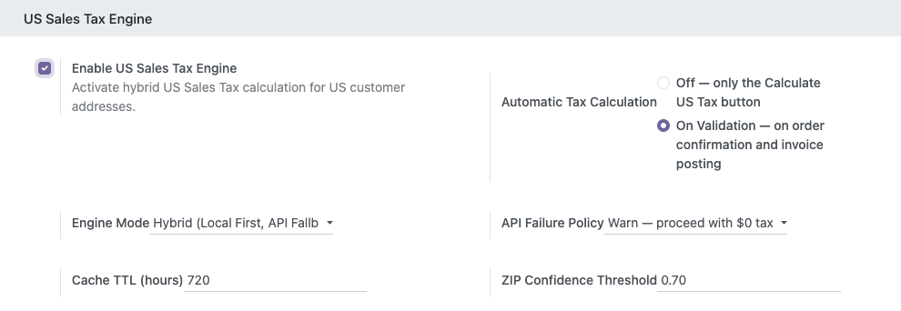
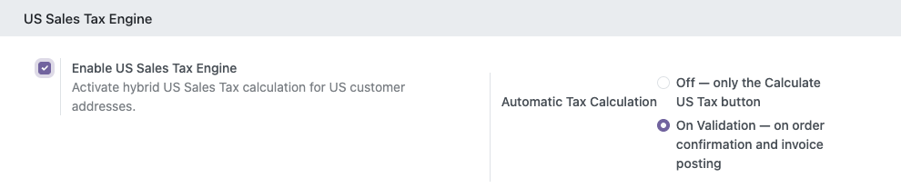
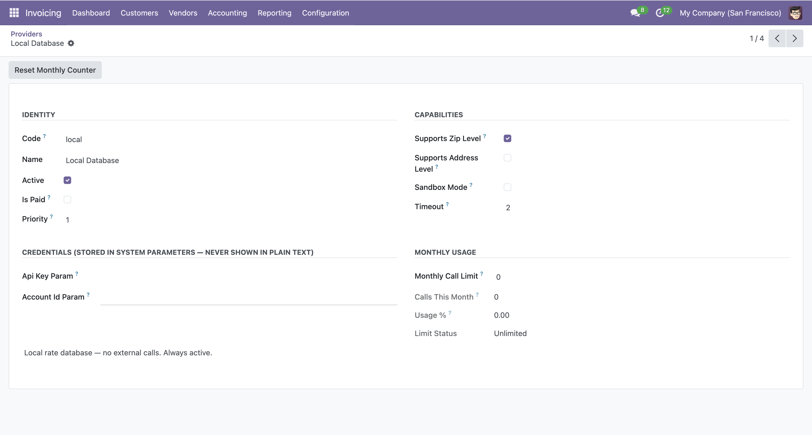
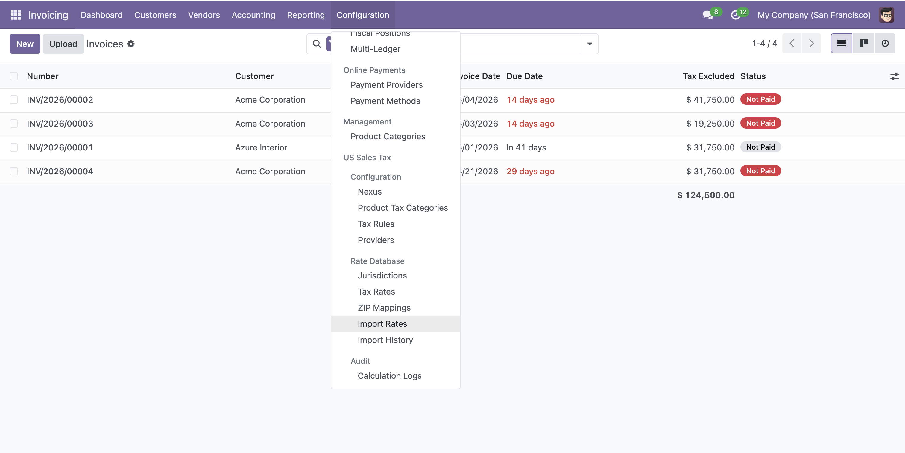
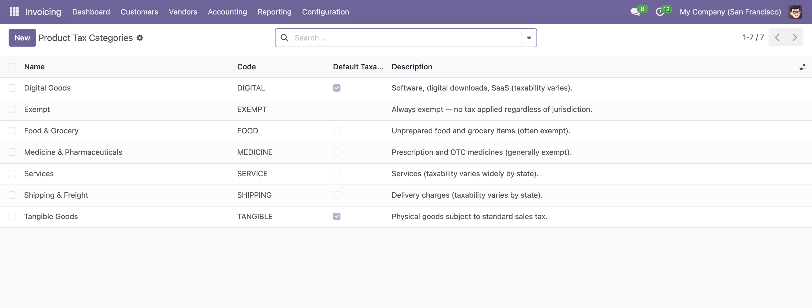
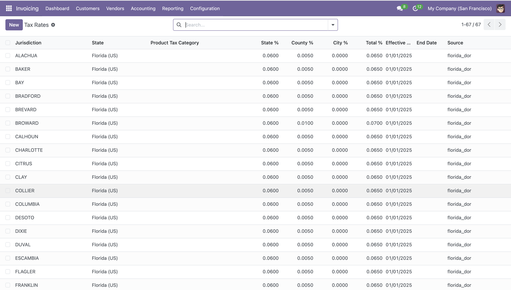
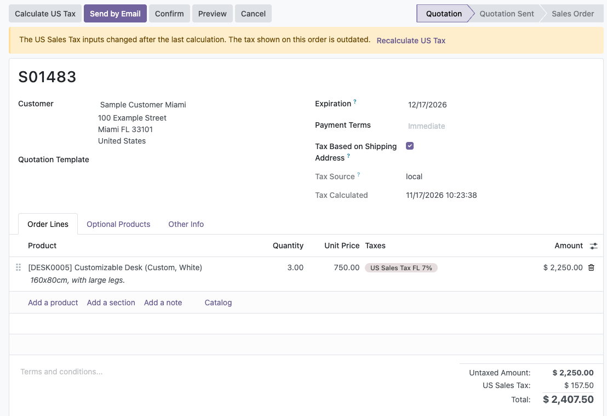
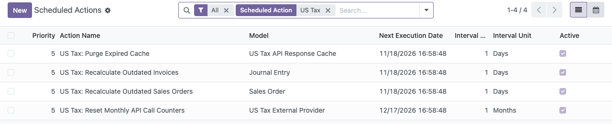

.. image:: https://odoo-community.org/readme-banner-image
   :target: https://odoo-community.org/get-involved?utm_source=readme
   :alt: Odoo Community Association

===================
US Sales Tax Engine
===================

.. 
   !!!!!!!!!!!!!!!!!!!!!!!!!!!!!!!!!!!!!!!!!!!!!!!!!!!!
   !! This file is generated by oca-gen-addon-readme !!
   !! changes will be overwritten.                   !!
   !!!!!!!!!!!!!!!!!!!!!!!!!!!!!!!!!!!!!!!!!!!!!!!!!!!!
   !! source digest: sha256:a9f5503af6a7ee4c946551669ec257278693c796de912d5770d1a3116da51d23
   !!!!!!!!!!!!!!!!!!!!!!!!!!!!!!!!!!!!!!!!!!!!!!!!!!!!

.. |badge1| image:: https://img.shields.io/badge/maturity-Alpha-red.png
    :target: https://odoo-community.org/page/development-status
    :alt: Alpha
.. |badge2| image:: https://img.shields.io/badge/license-LGPL--3-blue.png
    :target: http://www.gnu.org/licenses/lgpl-3.0-standalone.html
    :alt: License: LGPL-3
.. |badge3| image:: https://img.shields.io/badge/github-OCA%2Fl10n--usa-lightgray.png?logo=github
    :target: https://github.com/OCA/l10n-usa/tree/18.0/l10n_us_sales_tax_engine
    :alt: OCA/l10n-usa
.. |badge4| image:: https://img.shields.io/badge/weblate-Translate%20me-F47D42.png
    :target: https://translation.odoo-community.org/projects/l10n-usa-18-0/l10n-usa-18-0-l10n_us_sales_tax_engine
    :alt: Translate me on Weblate
.. |badge5| image:: https://img.shields.io/badge/runboat-Try%20me-875A7B.png
    :target: https://runboat.odoo-community.org/builds?repo=OCA/l10n-usa&target_branch=18.0
    :alt: Try me on Runboat

|badge1| |badge2| |badge3| |badge4| |badge5|

Hybrid US Sales Tax engine for Odoo: resolves the combined state +
county + city + district rate for a ZIP code, applies it to sale orders
and invoices, and keeps a full audit trail of every calculation.

Resolution order: local rate database first, external API providers as
fallback (configured independently in their own
``l10n_us_sales_tax_provider_*`` modules — this module never imports
their code directly). Tracks nexus per state, taxability per product
category, and caches external API responses to control call volume.

.. IMPORTANT::
   This is an alpha version, the data model and design can change at any time without warning.
   Only for development or testing purpose, do not use in production.
   `More details on development status <https://odoo-community.org/page/development-status>`_

**Table of contents**

.. contents::
   :local:

Configuration
=============

Enabling the engine
-------------------

**Settings → Invoicing → US Sales Tax Engine → Enable US Sales Tax
Engine** turns the engine on. Until it is ticked, the block shows
nothing else.

|Engine disabled|

Once it is ticked, the block shows **Automatic Tax Calculation**,
**Engine Mode**, **API Failure Policy**, **Cache TTL (hours)** and **ZIP
Confidence Threshold**.

|Engine enabled|

Automatic tax calculation
-------------------------

**Settings → Invoicing → US Sales Tax Engine → Automatic Tax
Calculation** decides when the engine runs without anyone pressing
**Calculate US Tax**. The option is shown once **Enable US Sales Tax
Engine** is ticked, and it has three modes:

- **Off — only the Calculate US Tax button.** Tax is calculated only
  when someone presses **Calculate US Tax** on the sale order or the
  customer invoice.
- **On Validation — on order confirmation and invoice posting.** The
  engine also runs when a sale order is confirmed and when a customer
  invoice or credit note is posted. This is the default, and it is also
  the mode of a database where no mode has ever been chosen.
- **Live — also as draft documents change, and daily.** On top of
  confirmation and posting, the engine runs whenever a document it may
  still change is edited in a way that moves the tax: a quantity, a
  price, a product, a line added, the customer or the delivery address
  chosen on the document, or the document date. The daily **US Tax:
  Recalculate Outdated Sales Orders** and **US Tax: Recalculate Outdated
  Invoices** scheduled actions recalculate the documents left outdated,
  such as the ones of a customer whose address or **US Tax Exempt** flag
  was edited on the contact. In the other two modes these scheduled
  actions do nothing.

Automatic calculation skips a document whose tax was already calculated
on the same inputs. A recalculation that an external provider answers,
rather than the cache or the local rate data, consumes an API call, so
**Live** is the mode that uses the most provider quota.

Unticking **Enable US Sales Tax Engine** stops every calculation,
whatever mode is stored, and hides the **Calculate US Tax** button and
the outdated-tax banner with its **Recalculate US Tax** button.

|Automatic Tax Calculation|

Scheduled actions
-----------------

The module ships four scheduled actions, all under **Settings →
Technical → Automation → Scheduled Actions** (developer mode), all
running as OdooBot.

**US Tax: Recalculate Outdated Sales Orders** and **US Tax: Recalculate
Outdated Invoices** (daily) only work in the **Live** mode. They are
described under *Usage*.

**US Tax: Purge Expired Cache** (daily) — archives the entries in
**Invoicing → Configuration → US Sales Tax → Audit → Cache** whose
expiry has passed. An API response is cached per ZIP, state, fiscal
category and month for as long as **Cache TTL (hours)** says, so that
repeated calculations on the same address cost no external call. The
cron only archives: nothing is deleted, and the archived entries stay
readable with the *Expired* filter, which keeps the record of what rate
was applied and when.

**US Tax: Reset Monthly API Call Counters** (monthly) — sets **Calls
This Month** back to zero on every provider and re-arms the warning that
fires at 80% of **Monthly Call Limit**. It exists because providers bill
per calendar month while Odoo counts continuously; a counter that never
resets would leave every provider looking exhausted. A provider with a
limit of 0 is unlimited and is not affected in practice. Both fields are
on each provider, under **Invoicing → Configuration → US Sales Tax →
Configuration → Providers**.

|Local Database provider|

Loading local rate data
-----------------------

The local provider needs three things before it can resolve a tax rate
for a ZIP code: a **Jurisdiction** (county/city), a **ZIP Mapping**
pointing that ZIP to the jurisdiction, and a **Tax Rate** on that
jurisdiction. None of these ship pre-loaded — only product categories
and the provider registry are seeded on install.

|US Sales Tax menu|

The seeded categories are under **Invoicing → Configuration → US Sales
Tax → Configuration → Product Tax Categories**.

|Product Tax Categories|

Import Tax Rates wizard
~~~~~~~~~~~~~~~~~~~~~~~

Invoicing → Configuration → US Sales Tax → Rate Database → Import Rates
always requires a file upload — there is no "instant, no file" option in
the wizard.

- **Florida DOR**: upload the official Master Address List CSV from
  https://pointmatch.floridarevenue.com/General/AddressFiles.aspx
  (select a county and effective date, then download). This creates the
  jurisdiction, the rate, **and** the ZIP mapping for every row — full
  ZIP-level resolution.
- **Generic CSV (any state)**: a file whose headers are, in lower case,
  ``zip``, ``county``, ``city`` and the rate columns ``state_rate``,
  ``county_rate``, ``city_rate``, ``district_rate`` and ``total_rate``.
  When ``total_rate`` is empty it is the sum of the other four. Each row
  creates the jurisdiction, the rate and the ZIP mapping in the same
  way.
- **Texas Open Data**: read with the Generic CSV columns.

Manual setup (quick test, single ZIP)
~~~~~~~~~~~~~~~~~~~~~~~~~~~~~~~~~~~~~

For testing a single ZIP without downloading a file, create the three
records by hand under Invoicing → Configuration → US Sales Tax → Rate
Database:

1. **Jurisdictions** — name, type (county/city), state.
2. **ZIP Mappings** — the ZIP code, pointing to that jurisdiction.
3. **Tax Rates** — the actual rate values on that jurisdiction.

|Tax Rates|

Nexus is independent of rate data
~~~~~~~~~~~~~~~~~~~~~~~~~~~~~~~~~

Creating a **Nexus** record (Invoicing → Configuration → US Sales Tax →
Configuration → Nexus) only marks that the company has a legal
obligation to collect tax in that state — it does not create or require
any jurisdiction, ZIP mapping, or rate. Both are needed independently
before a sale order calculates a non-zero local tax.

|Nexus|

.. |Engine disabled| image:: https://raw.githubusercontent.com/OCA/l10n-usa/18.0/l10n_us_sales_tax_engine/static/description/screenshot_01_settings_disabled.png

.. |Nexus| image:: https://raw.githubusercontent.com/OCA/l10n-usa/18.0/l10n_us_sales_tax_engine/static/description/screenshot_04_nexus.png

Usage
=====

Calculating US sales tax
------------------------

With **Enable US Sales Tax Engine** ticked, **Calculate US Tax** on the
sale order and on the customer invoice or credit note runs the engine on
demand. Depending on **Automatic Tax Calculation**, the engine also runs
on its own when a sale order is confirmed and when a customer invoice or
credit note is posted, and in the **Live** mode also as documents change
and from a daily scheduled action. Both settings live under *Settings →
Invoicing → US Sales Tax Engine* and are described in *Configuration*.

|Calculate US Tax on a draft invoice|

The engine prices a document only when the address it uses has its
country set to the United States and carries a ZIP and a state. A ZIP
and a state with no country are not taken for a US address. When the
engine runs on a document it had priced and that has since lost such an
address, it takes its own US Sales Tax taxes off the lines, leaves any
other tax where it is, and stops tracking the document: it shows no
banner and the cron leaves it alone. If those taxes cannot be taken off,
the run counts as a failed calculation, described below.

On a sale order with part of its lines already invoiced, only the lines
nothing has been invoiced from follow a new rate. The invoiced lines
keep the tax their invoice was issued with.

Outdated tax and the warning banner
~~~~~~~~~~~~~~~~~~~~~~~~~~~~~~~~~~~

Editing the *customer's* address does not recalculate every draft
document that customer has — that would block the transaction on a
customer with hundreds of quotations. Instead, each document keeps a
fingerprint of the inputs the engine reads, and those documents show a
warning banner saying the tax is outdated.

|Outdated tax banner on a quotation|

How an outdated document is brought up to date depends on **Automatic
Tax Calculation**:

- in every mode, the **Recalculate US Tax** button on the banner or the
  **Calculate US Tax** button;
- in **On Validation** and **Live**, also confirming the sale order or
  posting the invoice;
- in **Live**, also the next edit to the document itself and the daily
  cron.

A document the engine was never asked to price is not outdated and shows
no banner. One whose calculation was attempted and failed is, even when
that was its first calculation and it carries no tax yet.

"Outdated" means *outdated and still recalculable*. A document the
engine cannot write a tax onto never shows the banner and never reaches
the cron, and the **Calculate US Tax** and **Recalculate US Tax**
buttons are hidden on it: a posted or cancelled invoice, and a
cancelled, locked or fully invoiced sale order. Odoo freezes ``tax_ids``
on a posted move and protects ``tax_id`` on a locked order, so a button
there would clear the banner without changing a single tax. To
recalculate a posted invoice, reset it to draft; to recalculate a locked
order, unlock it. Either becomes outdated again on its own if its inputs
moved in the meantime.

For the same reason the fingerprint itself is only maintained inside
those states. A customer address change marks the customer's documents
that can still be recalculated and leaves the rest exactly as they were,
``write_date`` included — vendor bills of that customer among them.

Which changes mark a document as outdated
~~~~~~~~~~~~~~~~~~~~~~~~~~~~~~~~~~~~~~~~~

The fingerprint holds what the engine actually reads: the ZIP, the
state, the city and the country of the address it would use, the
customer's exemption flag, the document date, the company, and the
fiscal category and subtotal of each line it prices. On a sale order the
lines already invoiced are not part of it. A change to anything else
raises no banner. Two cases come up often:

- **ZIP+4 and other ZIP formatting.** The engine truncates the ZIP to
  its first five digits, so ``33101``, ``33101-4521`` and ``331014521``
  are the same ZIP to it. Rewriting one as another changes no rate and
  raises no banner.
- **Street.** The rate is resolved from ZIP, state, fiscal category and
  date; the street is not part of the cache key, so editing it returns
  the very same rate. It raises no banner either.

Which address the fingerprint watches depends on **Tax Based on Shipping
Address** on the sale order: with it ticked the delivery address counts
and the invoice address does not, and the other way round. An invoice is
always taxed on its delivery address. Odoo copies a company's address
only to its child contacts of type *Contact*, not to its delivery
addresses, so editing the customer's address leaves a separate delivery
address, and the documents taxed on it, as they were.

The recalculation cron
~~~~~~~~~~~~~~~~~~~~~~

**Settings → Technical → Automation → Scheduled Actions → US Tax:
Recalculate Outdated Sales Orders** and **US Tax: Recalculate Outdated
Invoices**, both daily. They only work in the **Live** mode; in **Off**
and **On Validation** a run ends at once without touching anything.
There is one per document model, so that a failure while processing sale
orders does not affect the invoices.

|US Tax scheduled actions|

*Why it exists.* Changing one customer's address can outdate every draft
quotation and invoice that customer has. Recalculating them on the spot
would hold the transaction open for as long as it takes to price
hundreds of documents, and would consume an API call for each one an
external provider answers — while the user waits on a partner form. So
the recalculation is deferred, and the cron is the unattended floor
under the other routes: it catches the documents nobody reopened and
nobody pressed the button on.

*What it does.* It looks for the documents that were calculated or
attempted at least once and whose inputs differ from the last
calculation, in the states the automation is allowed to touch:
quotations, confirmed sale orders that are unlocked and not fully
invoiced, and draft customer invoices and credit notes. It recalculates
them in batches of 10 and reports its progress to Odoo after each batch;
Odoo commits the batch and calls the job again while documents remain. A
worker stopped by its time limit loses the batch in progress, not the
ones before it.

A run only takes the documents not attempted since its scheduled time,
so each document is tried once per run. One that keeps failing waits for
the next run instead of keeping the job busy for as long as a provider
outage lasts.

**Run Manually**, on either scheduled action, processes a single batch
of 10; the documents still outdated wait for the next scheduled run.

A document whose calculation fails stays outdated, so the next run picks
it up again, including a document whose very first calculation failed
and that carries no tax yet. Every attempt the cron makes stamps the
document with its time, successful or not, and the queue is ordered by
it: never-attempted documents first, then the least recently attempted.

*Cost.* Every recalculation that an external provider answers, rather
than the cache or the local rate data, consumes an API call, which is
why the cron only runs in the **Live** mode. You can also lower its
frequency or deactivate it from the scheduled action itself.

Calculation logs
~~~~~~~~~~~~~~~~

**Invoicing → Configuration → US Sales Tax → Audit → Calculation Logs**
holds the rows the engine writes, with the document, the address, the
source of the rate, the rate breakdown, the taxable and tax amounts and
a **Status**. Which runs leave a row:

- every calculation on a US address with a ZIP and a state, whether it
  finds a rate or an exemption, or no provider answers;
- a run on a document whose address is not a US one, or has no ZIP or
  state, only when it takes the engine's own taxes off the lines or
  fails to. Its source reads *Skipped — Not a US Address* or *Skipped —
  No ZIP or State*. A run there that finds no tax of the engine on the
  lines leaves no row;
- no run at all while **Enable US Sales Tax Engine** is unticked.

The **Status** is:

- **Success** when the tax was found and written on the lines;
- **Error** when no provider answered, or the tax could not be written
  on the lines or taken off them;
- **Skipped** when the engine took its own taxes off a document whose
  address is not a US one, or has no ZIP or state.

|Calculation logs|

|Calculation log|

Where the Block failure policy applies
~~~~~~~~~~~~~~~~~~~~~~~~~~~~~~~~~~~~~~

Confirming a sale order or posting an invoice runs the engine only with
**Automatic Tax Calculation** set to **On Validation** or **Live**; what
this section says about confirming and posting applies to those modes.

With *API Failure Policy* set to *Block — prevent document
confirmation*, a calculation where every provider failed raises an
error. The **Calculate US Tax** button shows it to the user, and
confirming the sale order or posting the invoice is refused with *US
sales tax could not be calculated for …*; in both cases the document
stays as it was. When the **Live** mode recalculates a document because
it was created or edited, or the cron runs, the error is logged and
swallowed instead: a provider outage would otherwise make every draft
sale order and customer invoice impossible to edit. The document keeps
its previous tax, the audit row is recorded as an error, and the banner
and the cron keep asking for the calculation until a provider answers.

Under the other policies confirming or posting goes through. When no
provider answered, a note in the document's chatter says that the US
sales tax could not be calculated and asks to check the tax before
sending the document.

A tax that cannot be written on the lines never stops the confirmation
or the posting, whatever the policy. The note in the chatter then says
that the tax could not be written on the lines, that they kept the tax
they had, and asks to calculate it again before sending the document.

How automatic recalculation is triggered
~~~~~~~~~~~~~~~~~~~~~~~~~~~~~~~~~~~~~~~~

Every ``write()`` on a sale order or an invoice, the ``create()`` of an
invoice, and every ``create()`` and ``write()`` on their lines funnel
into a single method, ``_us_tax_auto_recalculate()``. Confirming a sale
order reaches it through the confirmation's own ``write()``; posting an
invoice calls it from ``_post()``, while the move is still a draft. It
reaches the engine only when all four of these hold:

1. **``us_tax_skip_auto`` is not in the context.** The engine writes the
   tax back onto the lines, and that write goes through the same
   overrides; this key is what stops it from calculating a second time
   on its own output.
2. **The mode allows it.** ``l10n_us_tax.engine_active`` and
   ``l10n_us_tax.auto_mode`` are read at runtime instead of being
   trusted from the settings form, because ``set_param()`` can write
   either one without going through it. With the engine disabled the
   mode is **Off** whatever is stored, and with no mode stored it is
   **On Validation**. **Off** never lets the engine run. **On
   Validation** lets it run only while a sale order is being confirmed
   or an invoice posted, which ``action_confirm()`` and ``_post()`` mark
   with the ``us_tax_validating`` context key. **Live** always lets it
   run.
3. **The document is in an allowed state.** Quotations and confirmed
   sale orders that are unlocked and not fully invoiced; draft customer
   invoices and credit notes. Posted, cancelled and locked documents are
   out because Odoo will not let a tax be written on them, and fully
   invoiced orders because no line is left for a new rate to reach.
4. **The fingerprint changed, or the write validates the document.**
   ``us_tax_input_hash`` differs from ``us_tax_calculated_hash``. The
   write that confirms a sale order and ``_post()`` skip this check:
   rates, rules and nexus are not in the fingerprint, so a validation
   always prices the document.

A calculation that fails does not count as one. When no provider answers
and the *API Failure Policy* is *Warn* or *Manual*, or *Use Last Cache*
finds no cached rate, the lines that already carried a US tax keep it
and the others get the 0% tax of their state. When the tax cannot be
written on the lines, everything the engine had written on them is
rolled back. In both cases the audit row is recorded as an error,
``us_tax_calculated_hash`` is cleared and the attempt is stamped, so the
document stays outdated: it shows the banner for as long as it can still
be recalculated, and in the **Live** mode the cron picks it up again. An
invoice that went on to be posted does not show it. **Tax Source** reads
``error`` and **Tax Calculated** gets the time of the attempt, so it is
visible on the document.

Nowhere in the module is there a list of "fields that cause a
recalculation". Any other write, including the one ``sale_stock`` makes
on the order while it is confirmed, reaches the engine only when it
moved the fingerprint.

**Creation is deliberately asymmetric.** In the **Live** mode an invoice
calculates tax when it is created, with or without lines; a quotation
calculates when it gets its first line, whether that line comes with the
creation or is added afterwards. The engine writes a
``us.tax.calculation.log`` row on every run on a US address with a ZIP
and a state, including the runs that price nothing, and a quotation is
routinely created empty and filled in afterwards — calculating an empty
quotation would log a row for each of those.

**Extending the fingerprint from another module.** It takes two
overrides: the compute, with your own dependencies, says *when* the
fingerprint is recomputed, and ``_us_tax_build_input_hash()`` says
*what* goes into it. The dependency alone recomputes the same value,
because the compute only reads what ``_us_tax_build_input_hash()``
returns.

.. code:: python

   import hashlib

   class SaleOrder(models.Model):
       _inherit = "sale.order"

       @api.depends("partner_id.my_custom_field")
       def _compute_us_tax_input_hash(self):
           super()._compute_us_tax_input_hash()

       def _us_tax_build_input_hash(self):
           fingerprint = super()._us_tax_build_input_hash()
           if not fingerprint:
               return fingerprint
           extra = f"{fingerprint}|{self.partner_id.my_custom_field}"
           return hashlib.sha256(extra.encode("utf-8")).hexdigest()

``Field.get_depends()`` collects the dependencies of every override of
the compute in the MRO, so yours are added to the ones this module
declares. Redefining the field with the ``depends=`` keyword instead
**replaces** that list rather than extending it, which silently drops
all of them.

The four hooks the dependency list is built from —
``_us_tax_partner_fields()``, ``_us_tax_partner_address_fields()``,
``_us_tax_extra_depends()`` and ``_us_tax_state_depends()`` — are
overridable too. All four are evaluated once per registry build, so they
have to return static lists, and a change only takes effect when the
module is upgraded.

A module adding a third document type inherits ``us.tax.auto.mixin`` and
implements ``_us_tax_get_address()``, ``_us_tax_get_date()``,
``_us_tax_get_lines()``, ``_us_tax_engine_run()``,
``_us_tax_state_domain()`` and ``_us_tax_state_depends()``. Its line
model inherits ``us.tax.line.hash.mixin``, which gives the lines their
part of the fingerprint and their ``create()``/``write()`` triggers, and
implements ``_us_tax_auto_parents()`` to return the documents its lines
belong to. The module also ships its own ``ir.cron`` record pointing at
its model and calling ``model._us_tax_cron_recalculate_stale()``. The
first three hooks are also what ``us.tax.engine.service`` reads, so
overriding one moves the fingerprint and what actually gets taxed
together.

Nexus in a company tree
~~~~~~~~~~~~~~~~~~~~~~~

A nexus also covers the branches of its company, at any depth: a
document of a branch or sub-branch is taxed in every state where that
branch or one of its parent companies has an active nexus. A nexus on a
branch covers the branch and its own branches, never its parent company
or its sibling branches.

The Nexus menu lists, for each company a user can access, its own nexus
and the ones of its parent companies, so a user who only accesses a
branch sees every nexus that taxes the branch documents. The nexus of
sibling branches stays hidden. A parent company nexus is read-only from
the branch: only a user with access to the company that owns it can edit
or delete it.

Zero-tax lines always carry an explicit tax, never an empty tax field
~~~~~~~~~~~~~~~~~~~~~~~~~~~~~~~~~~~~~~~~~~~~~~~~~~~~~~~~~~~~~~~~~~~~~

When a line ends up with 0% tax, the engine always assigns a real
``account.tax`` record rather than leaving the line untaxed:

- **Exempt product category, no nexus in that state, or a customer
  marked US Tax Exempt** — assigned the shared
  ``US Sales Tax - Exempt (0%)`` tax (one tax for all three reasons,
  across all states).
- **A state with a genuine 0% combined rate** (e.g. Oregon, Montana —
  states with no sales tax at all) — assigned
  ``US Sales Tax {state} 0%``, the same per-state-and-rate tax used for
  any other rate.

A line left at 0% because no provider answered carries
``US Sales Tax {state} 0%`` as well. The calculation log row recorded as
an error, and on confirmation or posting the chatter note, are what tell
it apart from a genuine 0% rate.

This is deliberate: an empty ``tax_id`` is indistinguishable from "tax
was never calculated" on an invoice or in a tax report filtered/grouped
by ``account.tax``/``account.tax.group``. An explicit 0% tax record
shows that the line was evaluated and a deliberate "no tax due"
determination was made — the kind of audit trail a sales-tax-exempt line
should leave behind.

The *specific* reason for a 0% line (which product category, which
state, nexus or no nexus) is not encoded in the tax's name — that level
of detail already lives on ``us.tax.calculation.log``, one record per
calculation. The tax itself only needs to answer "was this evaluated,
and is it taxable" at a glance.

**Reports on untaxed lines.** A report that looks for lines with no
``tax_id``/``tax_ids`` at all to find missing tax does not match the
lines the engine evaluated, because those carry the explicit 0% tax.

.. |Calculate US Tax on a draft invoice| image:: https://raw.githubusercontent.com/OCA/l10n-usa/18.0/l10n_us_sales_tax_engine/static/description/usage_calculate_button_invoice.png

.. |Calculation logs| image:: https://raw.githubusercontent.com/OCA/l10n-usa/18.0/l10n_us_sales_tax_engine/static/description/screenshot_05_calc_logs_list.png
.. |Calculation log| image:: https://raw.githubusercontent.com/OCA/l10n-usa/18.0/l10n_us_sales_tax_engine/static/description/screenshot_06_calc_log_detail.png

Known issues / Roadmap
======================

- When a document has no shipping address of its own and the engine
  falls back to the customer's ``delivery`` child contact, a change to
  *that contact's* address does not mark the document as outdated. Use
  the **Calculate US Tax** button on those documents.
- Rate data is not part of the fingerprint of a document: a new
  **Nexus**, **Tax Rate** or **Tax Rule** does not mark existing
  documents as outdated. **Calculate US Tax**, confirming the sale order
  or posting the invoice is what applies it to them.

Bug Tracker
===========

Bugs are tracked on `GitHub Issues <https://github.com/OCA/l10n-usa/issues>`_.
In case of trouble, please check there if your issue has already been reported.
If you spotted it first, help us to smash it by providing a detailed and welcomed
`feedback <https://github.com/OCA/l10n-usa/issues/new?body=module:%20l10n_us_sales_tax_engine%0Aversion:%2018.0%0A%0A**Steps%20to%20reproduce**%0A-%20...%0A%0A**Current%20behavior**%0A%0A**Expected%20behavior**>`_.

Do not contact contributors directly about support or help with technical issues.

Credits
=======

Authors
-------

* Binhex

Contributors
------------

- Carlos R. Rodriguez <c.rodriguez@binhex.cloud>
- Don Kendall <dkendall@ledoweb.com>
- Edilio Escalona Almira <e.escalona@binhex.cloud>

Maintainers
-----------

This module is maintained by the OCA.

.. image:: https://odoo-community.org/logo.png
   :alt: Odoo Community Association
   :target: https://odoo-community.org

OCA, or the Odoo Community Association, is a nonprofit organization whose
mission is to support the collaborative development of Odoo features and
promote its widespread use.

.. |maintainer-crrodrigueztrujillo| image:: https://github.com/crrodrigueztrujillo.png?size=40px
    :target: https://github.com/crrodrigueztrujillo
    :alt: crrodrigueztrujillo

Current `maintainer <https://odoo-community.org/page/maintainer-role>`__:

|maintainer-crrodrigueztrujillo| 

This module is part of the `OCA/l10n-usa <https://github.com/OCA/l10n-usa/tree/18.0/l10n_us_sales_tax_engine>`_ project on GitHub.

You are welcome to contribute. To learn how please visit https://odoo-community.org/page/Contribute.
