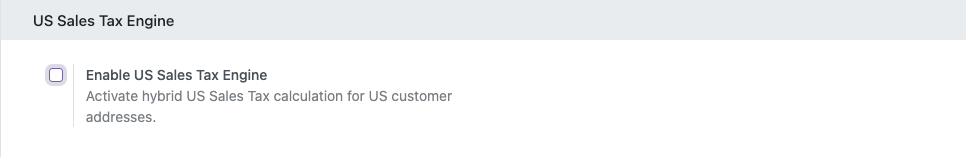
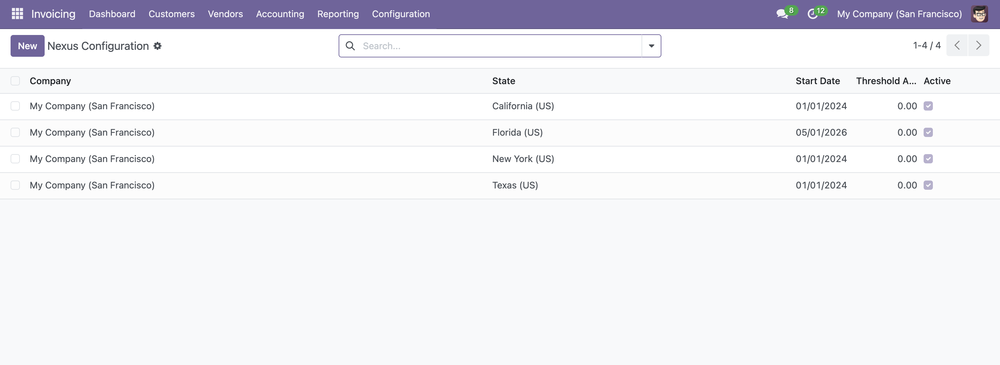
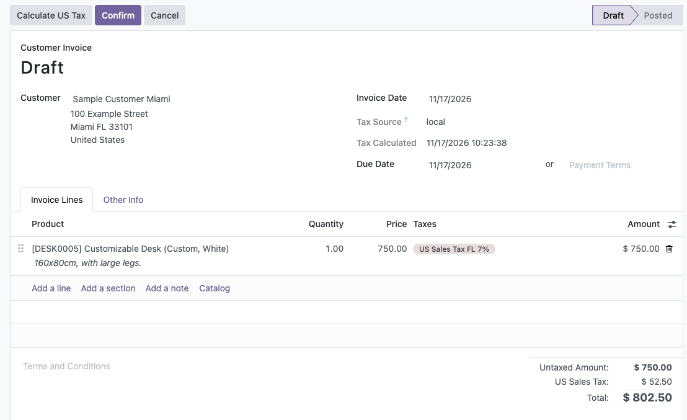
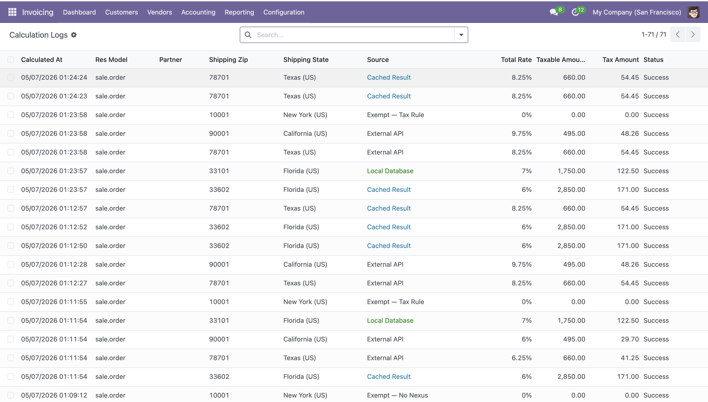
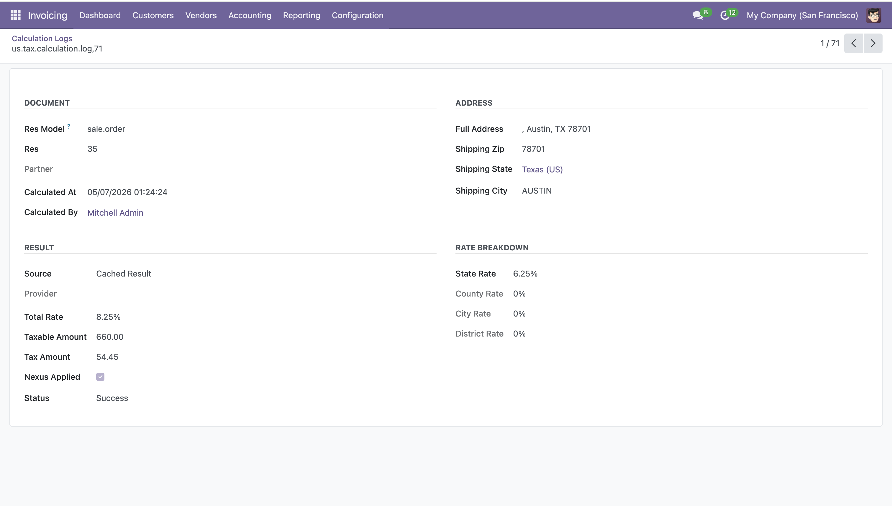

.. image:: https://odoo-community.org/readme-banner-image
   :target: https://odoo-community.org/get-involved?utm_source=readme
   :alt: Odoo Community Association

===================
US Sales Tax Engine
===================

.. 
   !!!!!!!!!!!!!!!!!!!!!!!!!!!!!!!!!!!!!!!!!!!!!!!!!!!!
   !! This file is generated by oca-gen-addon-readme !!
   !! changes will be overwritten.                   !!
   !!!!!!!!!!!!!!!!!!!!!!!!!!!!!!!!!!!!!!!!!!!!!!!!!!!!
   !! source digest: sha256:e3bebcddb94d844f1379424ed6eac4951138d3569c97ad7fa7d8091390ec9003
   !!!!!!!!!!!!!!!!!!!!!!!!!!!!!!!!!!!!!!!!!!!!!!!!!!!!

.. |badge1| image:: https://img.shields.io/badge/maturity-Alpha-red.png
    :target: https://odoo-community.org/page/development-status
    :alt: Alpha
.. |badge2| image:: https://img.shields.io/badge/license-LGPL--3-blue.png
    :target: http://www.gnu.org/licenses/lgpl-3.0-standalone.html
    :alt: License: LGPL-3
.. |badge3| image:: https://img.shields.io/badge/github-OCA%2Fl10n--usa-lightgray.png?logo=github
    :target: https://github.com/OCA/l10n-usa/tree/18.0/l10n_us_sales_tax_engine
    :alt: OCA/l10n-usa
.. |badge4| image:: https://img.shields.io/badge/weblate-Translate%20me-F47D42.png
    :target: https://translation.odoo-community.org/projects/l10n-usa-18-0/l10n-usa-18-0-l10n_us_sales_tax_engine
    :alt: Translate me on Weblate
.. |badge5| image:: https://img.shields.io/badge/runboat-Try%20me-875A7B.png
    :target: https://runboat.odoo-community.org/builds?repo=OCA/l10n-usa&target_branch=18.0
    :alt: Try me on Runboat

|badge1| |badge2| |badge3| |badge4| |badge5|

Hybrid US Sales Tax engine for Odoo: resolves the combined state +
county + city + district rate for a ZIP code, applies it to sale orders
and invoices, and keeps a full audit trail of every calculation.

Resolution order: local rate database first, external API providers as
fallback (configured independently in their own
``l10n_us_sales_tax_provider_*`` modules — this module never imports
their code directly). Tracks nexus per state, taxability per product
category, and caches external API responses to control call volume.

.. IMPORTANT::
   This is an alpha version, the data model and design can change at any time without warning.
   Only for development or testing purpose, do not use in production.
   `More details on development status <https://odoo-community.org/page/development-status>`_

**Table of contents**

.. contents::
   :local:

Configuration
=============

Enabling the engine
-------------------

**Settings → Invoicing → US Sales Tax Engine → Enable US Sales Tax
Engine** turns the engine on. Until it is ticked, the block shows
nothing else.

|Engine disabled|

Once it is ticked, the block shows **Automatic Tax Calculation**,
**Engine Mode**, **API Failure Policy**, **Cache TTL (hours)** and **ZIP
Confidence Threshold**.

|Engine enabled|

Automatic tax calculation
-------------------------

**Settings → Invoicing → US Sales Tax Engine → Automatic Tax
Calculation** decides when the engine runs without anyone pressing
**Calculate US Tax**. The option is shown once **Enable US Sales Tax
Engine** is ticked, and it has two modes:

- **Off — only the Calculate US Tax button.** Tax is calculated only
  when someone presses **Calculate US Tax** on the sale order or the
  customer invoice.
- **On Validation — on order confirmation and invoice posting.** The
  engine also runs when a sale order is confirmed and when a customer
  invoice or credit note is posted. This is the default, and it is also
  the mode of a database where no mode has ever been chosen.

Unticking **Enable US Sales Tax Engine** stops every calculation,
whatever mode is stored: confirming an order or posting an invoice
calculates nothing, and **Calculate US Tax**, which stays on the
documents, leaves their taxes as they are.

|Automatic Tax Calculation|

Scheduled actions
-----------------

The module ships two scheduled actions, both under **Settings →
Technical → Automation → Scheduled Actions** (developer mode), both
running as OdooBot.

**US Tax: Purge Expired Cache** (daily) — archives the entries in
**Invoicing → Configuration → US Sales Tax → Audit → Cache** whose
expiry has passed. An API response is cached per ZIP, state, fiscal
category and month for as long as **Cache TTL (hours)** says, so that
repeated calculations on the same address cost no external call. The
cron only archives: nothing is deleted, and the archived entries stay
readable with the *Expired* filter, which keeps the record of what rate
was applied and when.

**US Tax: Reset Monthly API Call Counters** (monthly) — sets **Calls
This Month** back to zero on every provider and re-arms the warning that
fires at 80% of **Monthly Call Limit**. It exists because providers bill
per calendar month while Odoo counts continuously; a counter that never
resets would leave every provider looking exhausted. A provider with a
limit of 0 is unlimited and is not affected in practice. Both fields are
on each provider, under **Invoicing → Configuration → US Sales Tax →
Configuration → Providers**.

|Local Database provider|

Loading local rate data
-----------------------

The local provider needs three things before it can resolve a tax rate
for a ZIP code: a **Jurisdiction** (county/city), a **ZIP Mapping**
pointing that ZIP to the jurisdiction, and a **Tax Rate** on that
jurisdiction. None of these ship pre-loaded — only product categories
and the provider registry are seeded on install.

|US Sales Tax menu|

The seeded categories are under **Invoicing → Configuration → US Sales
Tax → Configuration → Product Tax Categories**.

|Product Tax Categories|

Import Tax Rates wizard
~~~~~~~~~~~~~~~~~~~~~~~

Invoicing → Configuration → US Sales Tax → Rate Database → Import Rates
always requires a file upload — there is no "instant, no file" option in
the wizard.

- **Florida DOR**: upload the official Master Address List CSV from
  https://pointmatch.floridarevenue.com/General/AddressFiles.aspx
  (select a county and effective date, then download). This creates the
  jurisdiction, the rate, **and** the ZIP mapping for every row — full
  ZIP-level resolution.
- **Generic CSV (any state)**: a file whose headers are, in lower case,
  ``zip``, ``county``, ``city`` and the rate columns ``state_rate``,
  ``county_rate``, ``city_rate``, ``district_rate`` and ``total_rate``.
  When ``total_rate`` is empty it is the sum of the other four. Each row
  creates the jurisdiction, the rate and the ZIP mapping in the same
  way.
- **Texas Open Data**: read with the Generic CSV columns.

Manual setup (quick test, single ZIP)
~~~~~~~~~~~~~~~~~~~~~~~~~~~~~~~~~~~~~

For testing a single ZIP without downloading a file, create the three
records by hand under Invoicing → Configuration → US Sales Tax → Rate
Database:

1. **Jurisdictions** — name, type (county/city), state.
2. **ZIP Mappings** — the ZIP code, pointing to that jurisdiction.
3. **Tax Rates** — the actual rate values on that jurisdiction.

|Tax Rates|

Nexus is independent of rate data
~~~~~~~~~~~~~~~~~~~~~~~~~~~~~~~~~

Creating a **Nexus** record (Invoicing → Configuration → US Sales Tax →
Configuration → Nexus) only marks that the company has a legal
obligation to collect tax in that state — it does not create or require
any jurisdiction, ZIP mapping, or rate. Both are needed independently
before a sale order calculates a non-zero local tax.

|Nexus|

.. |Engine enabled| image:: https://raw.githubusercontent.com/OCA/l10n-usa/18.0/l10n_us_sales_tax_engine/static/description/screenshot_02_settings_enabled.png
.. |Automatic Tax Calculation| image:: https://raw.githubusercontent.com/OCA/l10n-usa/18.0/l10n_us_sales_tax_engine/static/description/configure_automatic_tax_calculation.png
.. |Local Database provider| image:: https://raw.githubusercontent.com/OCA/l10n-usa/18.0/l10n_us_sales_tax_engine/static/description/screenshot_09_provider_local.png
.. |US Sales Tax menu| image:: https://raw.githubusercontent.com/OCA/l10n-usa/18.0/l10n_us_sales_tax_engine/static/description/screenshot_03_menu.png
.. |Product Tax Categories| image:: https://raw.githubusercontent.com/OCA/l10n-usa/18.0/l10n_us_sales_tax_engine/static/description/screenshot_07_product_categories.png
.. |Tax Rates| image:: https://raw.githubusercontent.com/OCA/l10n-usa/18.0/l10n_us_sales_tax_engine/static/description/screenshot_11_tax_rates.png

Usage
=====

Calculating US sales tax
------------------------

With **Enable US Sales Tax Engine** ticked, **Calculate US Tax** on the
sale order and on the customer invoice or credit note runs the engine on
demand. Depending on **Automatic Tax Calculation**, the engine also runs
on its own when a sale order is confirmed and when a customer invoice or
credit note is posted. Both settings live under *Settings → Invoicing →
US Sales Tax Engine* and are described in *Configuration*.

|Calculate US Tax on a draft invoice|

The engine prices a document only when the address it uses has its
country set to the United States and carries a ZIP and a state. A ZIP
and a state with no country are not taken for a US address. When the
engine runs on a document it had priced and that has since lost such an
address, it takes its own US Sales Tax taxes off the lines and leaves
any other tax where it is.

Calculation logs
~~~~~~~~~~~~~~~~

**Invoicing → Configuration → US Sales Tax → Audit → Calculation Logs**
holds the rows the engine writes, with the document, the address, the
source of the rate, the rate breakdown, the taxable and tax amounts and
a **Status**. Which runs leave a row:

- every calculation on a US address with a ZIP and a state, whether it
  finds a rate or an exemption, or no provider answers;
- a run on a document whose address is not a US one, or has no ZIP or
  state, only when it takes the engine's own taxes off the lines or
  fails to. Its source reads *Skipped — Not a US Address* or *Skipped —
  No ZIP or State*. A run there that finds no tax of the engine on the
  lines leaves no row;
- no run at all while **Enable US Sales Tax Engine** is unticked.

The **Status** is:

- **Success** when the tax was found and written on the lines;
- **Error** when no provider answered, or the tax could not be written
  on the lines or taken off them;
- **Skipped** when the engine took its own taxes off a document whose
  address is not a US one, or has no ZIP or state.

|Calculation logs|

|Calculation log|

Where the Block failure policy applies
~~~~~~~~~~~~~~~~~~~~~~~~~~~~~~~~~~~~~~

What follows applies with **Automatic Tax Calculation** set to **On
Validation**, the mode that runs the engine on order confirmation and
invoice posting.

With *API Failure Policy* set to *Block — prevent document
confirmation*, a calculation where every provider failed raises an
error. Confirming the sale order or posting the invoice is refused with
*US sales tax could not be calculated for …*, and the document stays as
it was.

Under the other policies confirming or posting goes through. When no
provider answered, a note in the document's chatter says that the US
sales tax could not be calculated and asks to check the tax before
sending the document.

A tax that cannot be written on the lines never stops the confirmation
or the posting, whatever the policy. The note in the chatter then says
that the tax could not be written on the lines, that they kept the tax
they had, and asks to calculate it again before sending the document.

Nexus in a company tree
~~~~~~~~~~~~~~~~~~~~~~~

A nexus also covers the branches of its company, at any depth: a
document of a branch or sub-branch is taxed in every state where that
branch or one of its parent companies has an active nexus. A nexus on a
branch covers the branch and its own branches, never its parent company
or its sibling branches.

The Nexus menu lists, for each company a user can access, its own nexus
and the ones of its parent companies, so a user who only accesses a
branch sees every nexus that taxes the branch documents. The nexus of
sibling branches stays hidden. A parent company nexus is read-only from
the branch: only a user with access to the company that owns it can edit
or delete it.

Zero-tax lines always carry an explicit tax, never an empty tax field
~~~~~~~~~~~~~~~~~~~~~~~~~~~~~~~~~~~~~~~~~~~~~~~~~~~~~~~~~~~~~~~~~~~~~

When a line ends up with 0% tax, the engine always assigns a real
``account.tax`` record rather than leaving the line untaxed:

- **Exempt product category, no nexus in that state, or a customer
  marked US Tax Exempt** — assigned the shared
  ``US Sales Tax - Exempt (0%)`` tax (one tax for all three reasons,
  across all states).
- **A state with a genuine 0% combined rate** (e.g. Oregon, Montana —
  states with no sales tax at all) — assigned
  ``US Sales Tax {state} 0%``, the same per-state-and-rate tax used for
  any other rate.

A line left at 0% because no provider answered carries
``US Sales Tax {state} 0%`` as well. The calculation log row recorded as
an error, and on confirmation or posting the chatter note, are what tell
it apart from a genuine 0% rate.

This is deliberate: an empty ``tax_id`` is indistinguishable from "tax
was never calculated" on an invoice or in a tax report filtered/grouped
by ``account.tax``/``account.tax.group``. An explicit 0% tax record
shows that the line was evaluated and a deliberate "no tax due"
determination was made — the kind of audit trail a sales-tax-exempt line
should leave behind.

The *specific* reason for a 0% line (which product category, which
state, nexus or no nexus) is not encoded in the tax's name — that level
of detail already lives on ``us.tax.calculation.log``, one record per
calculation. The tax itself only needs to answer "was this evaluated,
and is it taxable" at a glance.

**Reports on untaxed lines.** A report that looks for lines with no
``tax_id``/``tax_ids`` at all to find missing tax does not match the
lines the engine evaluated, because those carry the explicit 0% tax.

Bug Tracker
===========

Bugs are tracked on `GitHub Issues <https://github.com/OCA/l10n-usa/issues>`_.
In case of trouble, please check there if your issue has already been reported.
If you spotted it first, help us to smash it by providing a detailed and welcomed
`feedback <https://github.com/OCA/l10n-usa/issues/new?body=module:%20l10n_us_sales_tax_engine%0Aversion:%2018.0%0A%0A**Steps%20to%20reproduce**%0A-%20...%0A%0A**Current%20behavior**%0A%0A**Expected%20behavior**>`_.

Do not contact contributors directly about support or help with technical issues.

Credits
=======

Authors
-------

* Binhex

Contributors
------------

- Carlos R. Rodriguez <c.rodriguez@binhex.cloud>
- Don Kendall <dkendall@ledoweb.com>
- Edilio Escalona Almira <e.escalona@binhex.cloud>

Maintainers
-----------

This module is maintained by the OCA.

.. image:: https://odoo-community.org/logo.png
   :alt: Odoo Community Association
   :target: https://odoo-community.org

OCA, or the Odoo Community Association, is a nonprofit organization whose
mission is to support the collaborative development of Odoo features and
promote its widespread use.

.. |maintainer-crrodrigueztrujillo| image:: https://github.com/crrodrigueztrujillo.png?size=40px
    :target: https://github.com/crrodrigueztrujillo
    :alt: crrodrigueztrujillo

Current `maintainer <https://odoo-community.org/page/maintainer-role>`__:

|maintainer-crrodrigueztrujillo| 

This module is part of the `OCA/l10n-usa <https://github.com/OCA/l10n-usa/tree/18.0/l10n_us_sales_tax_engine>`_ project on GitHub.

You are welcome to contribute. To learn how please visit https://odoo-community.org/page/Contribute.
