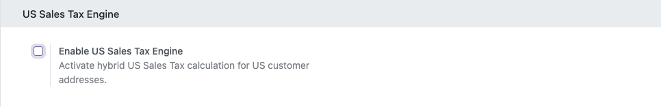
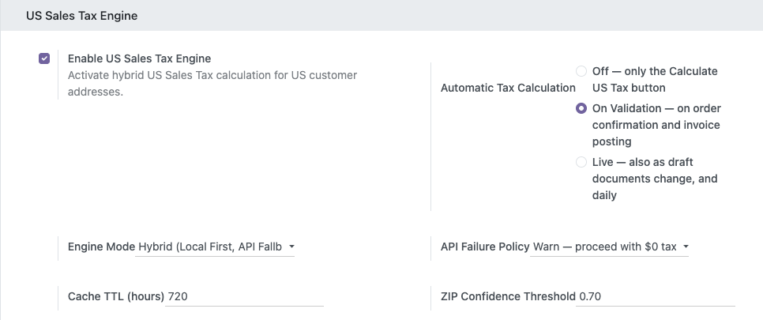
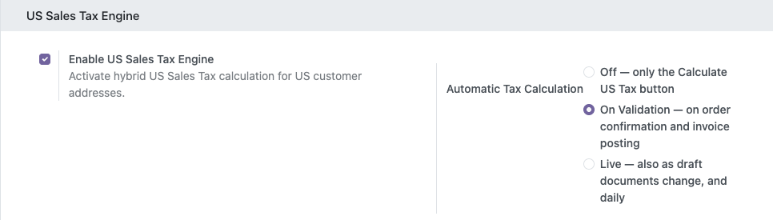
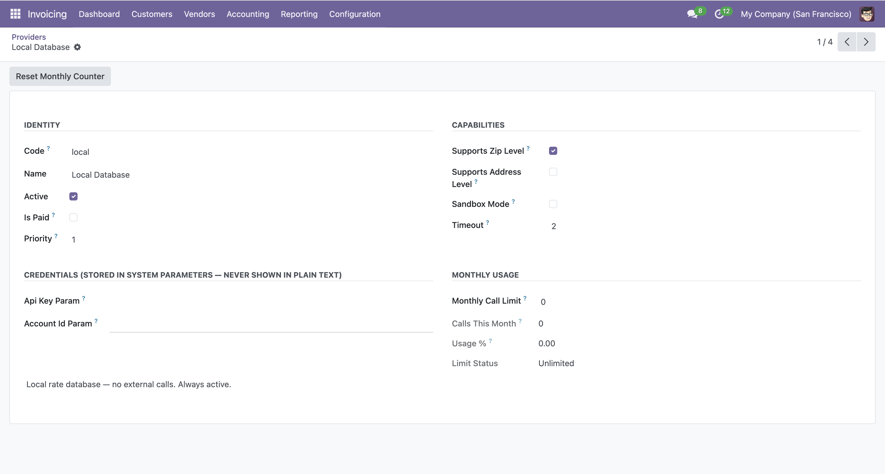
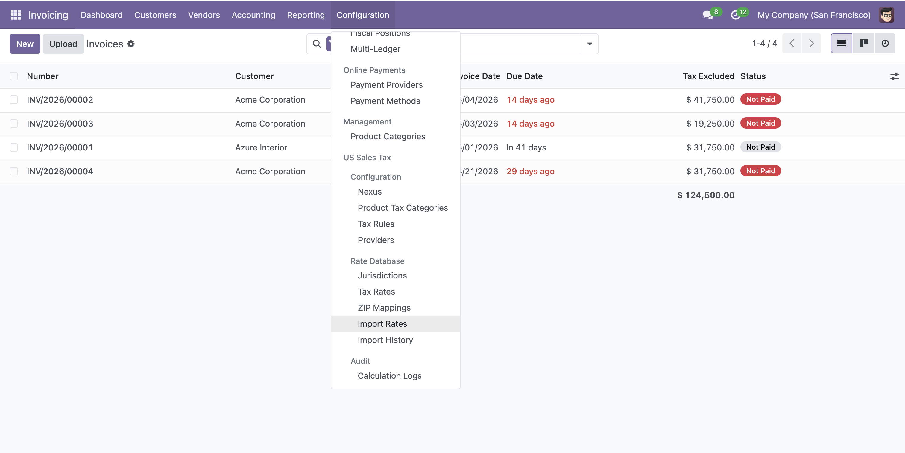
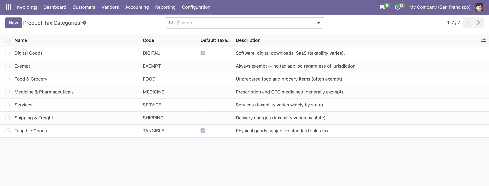
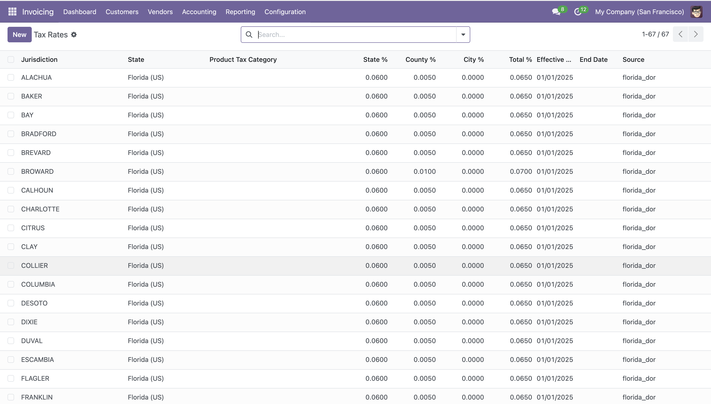
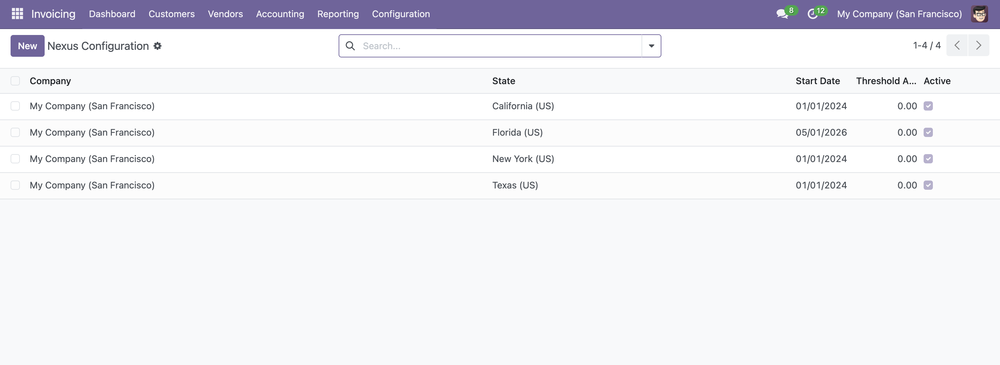

## Enabling the engine

**Settings → Invoicing → US Sales Tax Engine → Enable US Sales Tax
Engine** turns the engine on. Until it is ticked, the block shows
nothing else.

Once it is ticked, the block shows **Automatic Tax Calculation**,
**Engine Mode**, **API Failure Policy**, **Cache TTL (hours)** and **ZIP
Confidence Threshold**.

## Automatic tax calculation

**Settings → Invoicing → US Sales Tax Engine → Automatic Tax Calculation**
decides when the engine runs without anyone pressing **Calculate US Tax**.
The option is shown once **Enable US Sales Tax Engine** is ticked, and it
has three modes:

- **Off — only the Calculate US Tax button.** Tax is calculated only
  when someone presses **Calculate US Tax** on the sale order or the
  customer invoice.
- **On Validation — on order confirmation and invoice posting.** The
  engine also runs when a sale order is confirmed and when a customer
  invoice or credit note is posted. This is the default, and it is also
  the mode of a database where no mode has ever been chosen.
- **Live — also as draft documents change, and daily.** On top of
  confirmation and posting, the engine runs whenever a document it may
  still change is edited in a way that moves the tax: a quantity, a
  price, a product, a line added, the customer or the delivery address
  chosen on the document, or the document date. The daily **US Tax:
  Recalculate Outdated Sales Orders** and **US Tax: Recalculate Outdated
  Invoices** scheduled actions recalculate the documents left outdated,
  such as the ones of a customer whose address or **US Tax Exempt** flag
  was edited on the contact. In the other two modes these scheduled
  actions do nothing.

Automatic calculation skips a document whose tax was already calculated
on the same inputs. A recalculation that an external provider answers,
rather than the cache or the local rate data, consumes an API call, so
**Live** is the mode that uses the most provider quota.

Unticking **Enable US Sales Tax Engine** stops every calculation,
whatever mode is stored, and hides the **Calculate US Tax** button and
the outdated-tax banner with its **Recalculate US Tax** button.

## Scheduled actions

The module ships four scheduled actions, all under **Settings →
Technical → Automation → Scheduled Actions** (developer mode), all
running as OdooBot.

**US Tax: Recalculate Outdated Sales Orders** and **US Tax: Recalculate
Outdated Invoices** (daily) only work in the **Live** mode. They are
described under *Usage*.

**US Tax: Purge Expired Cache** (daily) — archives the entries in
**Invoicing → Configuration → US Sales Tax → Audit → Cache** whose expiry
has passed. An API response is cached per ZIP, state, fiscal category
and month for as long as **Cache TTL (hours)** says, so that repeated
calculations on the same address cost no external call. The cron only
archives: nothing is deleted, and the archived entries stay readable
with the *Expired* filter, which keeps the record of what rate was
applied and when.

**US Tax: Reset Monthly API Call Counters** (monthly) — sets
**Calls This Month** back to zero on every provider and re-arms the
warning that fires at 80% of **Monthly Call Limit**. It exists because
providers bill per calendar month while Odoo counts continuously; a
counter that never resets would leave every provider looking exhausted.
A provider with a limit of 0 is unlimited and is not affected in
practice. Both fields are on each provider, under **Invoicing →
Configuration → US Sales Tax → Configuration → Providers**.

## Loading local rate data

The local provider needs three things before it can resolve a tax rate for a
ZIP code: a **Jurisdiction** (county/city), a **ZIP Mapping** pointing that
ZIP to the jurisdiction, and a **Tax Rate** on that jurisdiction. None of
these ship pre-loaded — only product categories and the provider registry
are seeded on install.

The seeded categories are under **Invoicing → Configuration → US Sales
Tax → Configuration → Product Tax Categories**.

### Import Tax Rates wizard

Invoicing → Configuration → US Sales Tax → Rate Database → Import Rates
always requires a file upload — there is no "instant, no file" option in
the wizard.

- **Florida DOR**: upload the official Master Address List CSV from
  https://pointmatch.floridarevenue.com/General/AddressFiles.aspx (select a
  county and effective date, then download). This creates the jurisdiction,
  the rate, **and** the ZIP mapping for every row — full ZIP-level
  resolution.
- **Generic CSV (any state)**: a file whose headers are, in lower case,
  `zip`, `county`, `city` and the rate columns `state_rate`,
  `county_rate`, `city_rate`, `district_rate` and `total_rate`. When
  `total_rate` is empty it is the sum of the other four. Each row creates
  the jurisdiction, the rate and the ZIP mapping in the same way.
- **Texas Open Data**: read with the Generic CSV columns.

### Manual setup (quick test, single ZIP)

For testing a single ZIP without downloading a file, create the three
records by hand under Invoicing → Configuration → US Sales Tax → Rate
Database:
1. **Jurisdictions** — name, type (county/city), state.
2. **ZIP Mappings** — the ZIP code, pointing to that jurisdiction.
3. **Tax Rates** — the actual rate values on that jurisdiction.

### Nexus is independent of rate data

Creating a **Nexus** record (Invoicing → Configuration → US Sales Tax →
Configuration → Nexus) only marks that the company has a legal obligation
to collect tax in that state — it does not create or require any
jurisdiction, ZIP mapping, or rate. Both are needed independently before
a sale order calculates a non-zero local tax.

