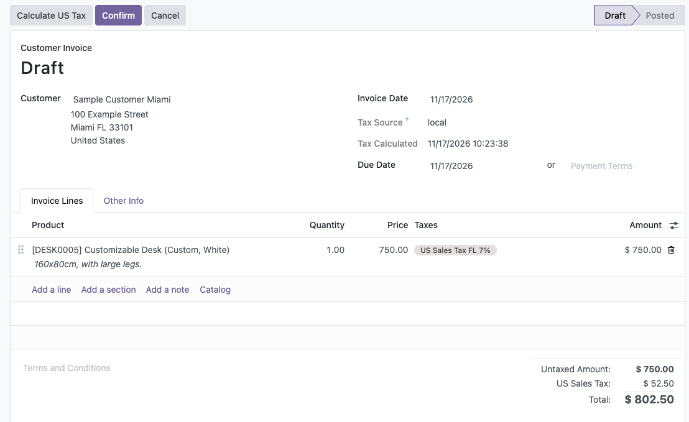
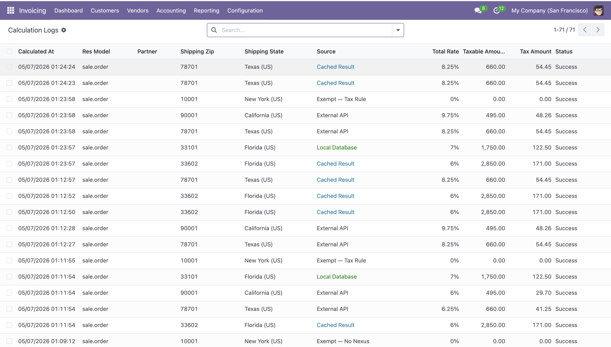
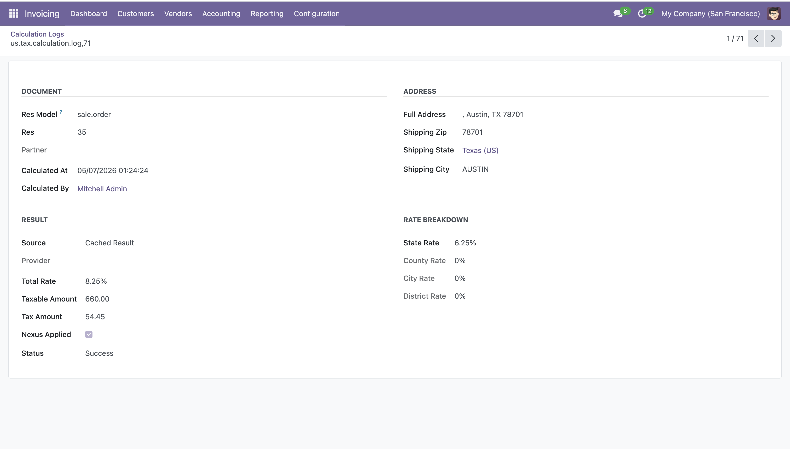

## Calculating US sales tax

With **Enable US Sales Tax Engine** ticked, **Calculate US Tax** on the
sale order and on the customer invoice or credit note runs the engine
on demand. Depending on **Automatic Tax Calculation**, the engine also
runs on its own when a sale order is confirmed and when a customer
invoice or credit note is posted. Both settings live under *Settings →
Invoicing → US Sales Tax Engine* and are described in *Configuration*.

The engine prices a document only when the address it uses has its
country set to the United States and carries a ZIP and a state. A ZIP
and a state with no country are not taken for a US address. When the
engine runs on a document it had priced and that has since lost such
an address, it takes its own US Sales Tax taxes off the lines and leaves
any other tax where it is.

### Calculation logs

**Invoicing → Configuration → US Sales Tax → Audit → Calculation Logs**
holds the rows the engine writes, with the document, the address, the
source of the rate, the rate breakdown, the taxable and tax amounts and
a **Status**. Which runs leave a row:

- every calculation on a US address with a ZIP and a state, whether it
  finds a rate or an exemption, or no provider answers;
- a run on a document whose address is not a US one, or has no ZIP or
  state, only when it takes the engine's own taxes off the lines or
  fails to. Its source reads *Skipped — Not a US Address* or *Skipped —
  No ZIP or State*. A run there that finds no tax of the engine on the
  lines leaves no row;
- no run at all while **Enable US Sales Tax Engine** is unticked.

The **Status** is:

- **Success** when the tax was found and written on the lines;
- **Error** when no provider answered, or the tax could not be written
  on the lines or taken off them;
- **Skipped** when the engine took its own taxes off a document whose
  address is not a US one, or has no ZIP or state.

### Where the Block failure policy applies

What follows applies with **Automatic Tax Calculation** set to
**On Validation**, the mode that runs the engine on order confirmation
and invoice posting.

With *API Failure Policy* set to *Block — prevent document
confirmation*, a calculation where every provider failed raises an
error. Confirming the sale order or posting the invoice is refused with
*US sales tax could not be calculated for …*, and the document stays as
it was.

Under the other policies confirming or posting goes through. When no
provider answered, a note in the document's chatter says that the US
sales tax could not be calculated and asks to check the tax before
sending the document.

A tax that cannot be written on the lines never stops the confirmation
or the posting, whatever the policy. The note in the chatter then says
that the tax could not be written on the lines, that they kept the tax
they had, and asks to calculate it again before sending the document.

### Zero-tax lines always carry an explicit tax, never an empty tax field

When a line ends up with 0% tax, the engine always assigns a real
`account.tax` record rather than leaving the line untaxed:

- **Exempt product category, no nexus in that state, or a customer
  marked US Tax Exempt** — assigned the shared `US Sales Tax - Exempt
  (0%)` tax (one tax for all three reasons, across all states).
- **A state with a genuine 0% combined rate** (e.g. Oregon, Montana — states
  with no sales tax at all) — assigned `US Sales Tax {state} 0%`, the same
  per-state-and-rate tax used for any other rate.

A line left at 0% because no provider answered carries `US Sales Tax
{state} 0%` as well. The calculation log row recorded as an error, and
on confirmation or posting the chatter note, are what tell it apart from
a genuine 0% rate.

This is deliberate: an empty `tax_id` is indistinguishable from "tax was
never calculated" on an invoice or in a tax report filtered/grouped by
`account.tax`/`account.tax.group`. An explicit 0% tax record shows that the
line was evaluated and a deliberate "no tax due" determination was made —
the kind of audit trail a sales-tax-exempt line should leave behind.

The *specific* reason for a 0% line (which product category, which state,
nexus or no nexus) is not encoded in the tax's name — that level of detail
already lives on `us.tax.calculation.log`, one record per calculation. The
tax itself only needs to answer "was this evaluated, and is it taxable" at
a glance.

**Reports on untaxed lines.** A report that looks for lines with no
`tax_id`/`tax_ids` at all to find missing tax does not match the lines
the engine evaluated, because those carry the explicit 0% tax.
