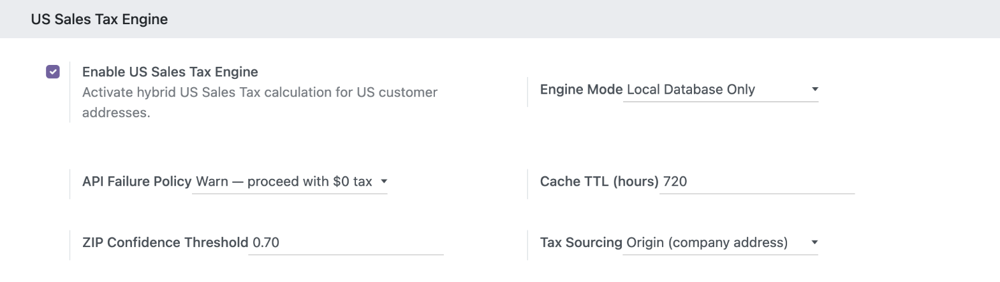
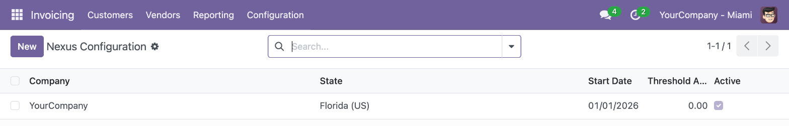

To configure this module, you need to:

1. Select, in the company switcher, the company or branch to configure: the
   setting is stored per company.
2. Go to *Settings > Invoicing > US Sales Tax Engine*. The *Tax Sourcing*
   setting is only shown when *Enable US Sales Tax Engine* is checked.
3. Choose the *Tax Sourcing* of the company:
   - *Destination (customer address)*, the default: new documents are rated
     with the customer's delivery address, as with the engine alone.
   - *Origin (company address)*: new sales orders and customer invoices are
     rated with the company address. The company needs a 5-digit ZIP, a state
     and United States as country; otherwise the setting cannot be saved.
4. Save.

Changing the setting only affects documents created afterwards. Existing
documents keep the check they already have; the ones that exist when the module
is installed start with the check off, so their rating does not change.

To declare the nexus of a company tree:

1. Go to *Invoicing > Configuration > US Sales Tax > Configuration > Nexus*.
2. Create the nexus on the parent company. It applies to the parent and to all
   its branches, so there is no need to repeat it on each branch.
3. A branch cannot cancel the nexus of a parent: while the parent's nexus is
   active, the branch collects tax in that state even if its own nexus record
   is archived. A nexus on a sibling branch does not apply.

With origin sourcing, the nexus that matters is the one in the state of the
company address, since that is the address being rated.
