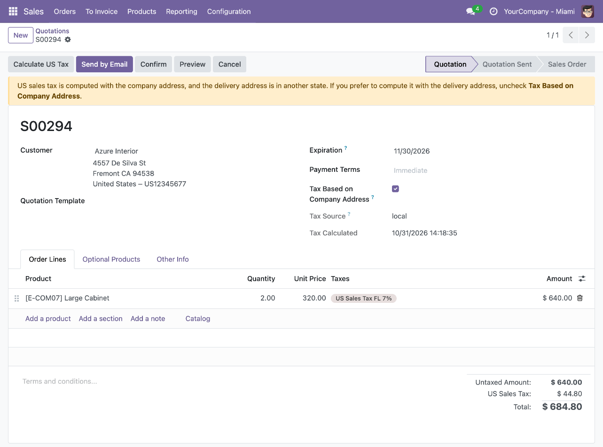
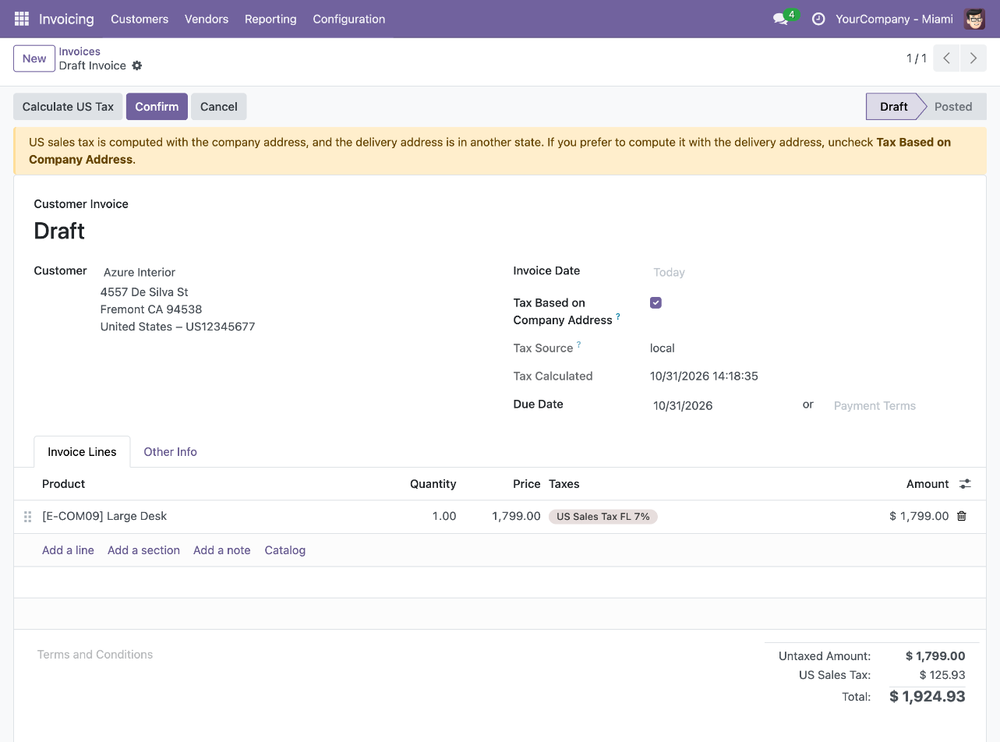
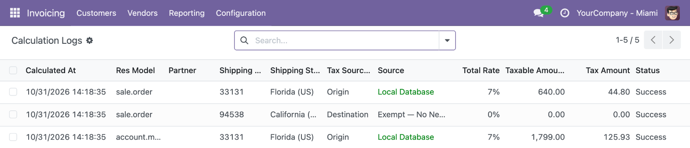

To use this module, you need to:

1. Create a sales order or a customer invoice. The *Tax Based on Company
   Address* check comes:
   - checked when the company uses *Origin* sourcing, unless the customer's
     delivery country is set and is not the United States;
   - unchecked when the company uses *Destination* sourcing.
2. Leave the check on to rate the tax with the address of the document's
   company or branch, for example for an in-store pickup. Uncheck it to rate
   with the customer's address: on the sales order, *Tax Based on Shipping
   Address* shows again and chooses between the customer's delivery and invoice
   addresses; customer invoices always use the delivery address.
3. Click *Calculate US Tax*, or confirm the order. With the check on, the rate
   is the one of the company ZIP and the tax is named after the company's
   state (`US Sales Tax <state> <rate>%`).

The check can be changed while the order is a quotation (sent or not) and
while the invoice is in draft. It is recomputed when the company or the
delivery address of the document changes. Changing the company setting, or the
state or country of a customer, does not change existing documents.

When the check is on and the delivery address is in a different state from the
company's, the draft order or invoice shows a warning. It does not block
anything: uncheck *Tax Based on Company Address* to rate with the delivery
address instead.

Invoices:

- An invoice created from a sales order takes the order's check. Orders with a
  different value are never grouped in the same invoice.
- A credit note keeps the check of its invoice.
- Posting a customer invoice rates it again with its own check.

Special cases:

- Customer outside the United States: no US tax, as with the engine alone,
  even if the check is on.
- Customer without an address (counter sale): rated with the company address
  when the check is on.
- Company without a complete US address (5-digit ZIP, state and United States
  as country) on a document with the check on: the customer's address is used
  and a warning is written to the server log.

In *Invoicing > Configuration > US Sales Tax > Audit > Calculation Logs*, the
*Tax Sourcing* column, also shown in the *Address* group of each log, tells
whether the rated address was the customer's (*Destination*) or the company's
(*Origin*). The address fields of the log show the address actually rated.

