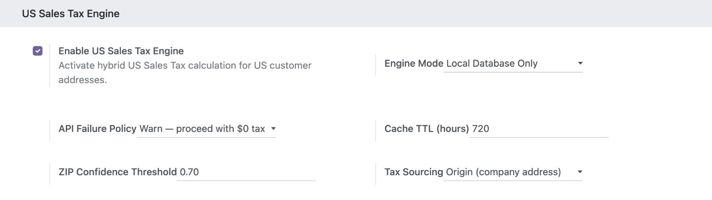
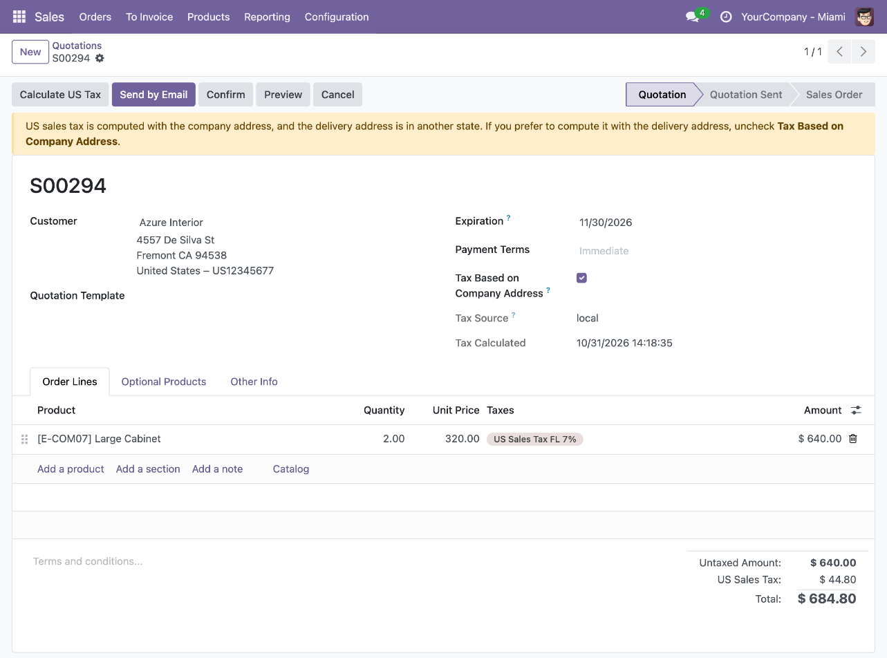
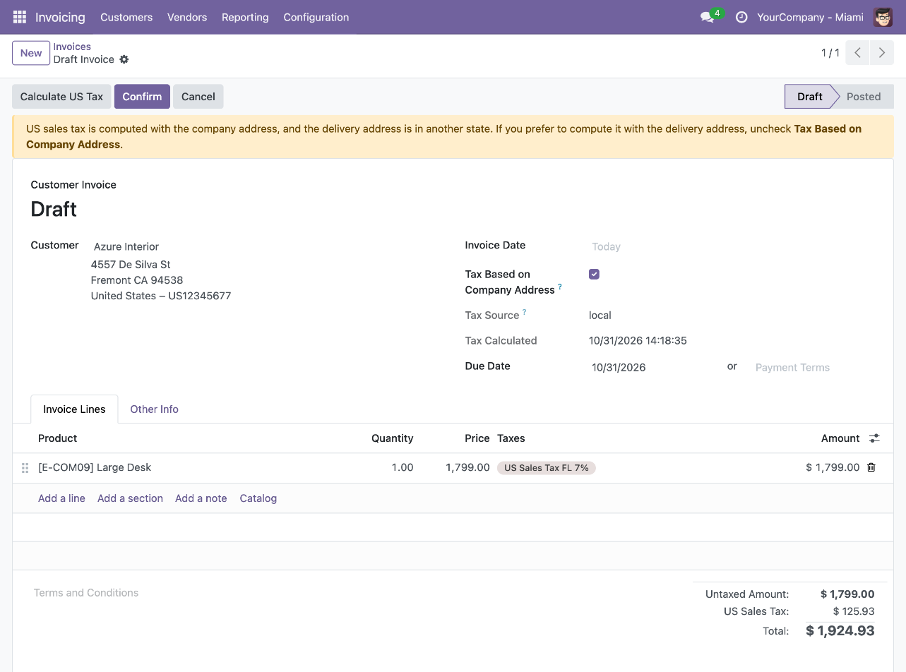
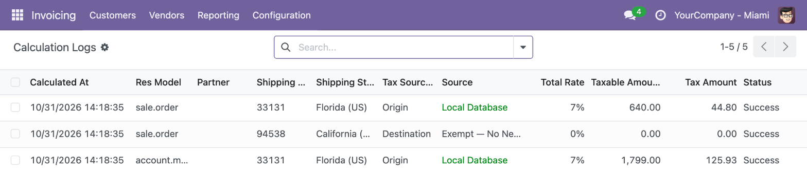

.. image:: https://odoo-community.org/readme-banner-image
   :target: https://odoo-community.org/get-involved?utm_source=readme
   :alt: Odoo Community Association

=====================================
US Sales Tax Engine - Origin Sourcing
=====================================

.. 
   !!!!!!!!!!!!!!!!!!!!!!!!!!!!!!!!!!!!!!!!!!!!!!!!!!!!
   !! This file is generated by oca-gen-addon-readme !!
   !! changes will be overwritten.                   !!
   !!!!!!!!!!!!!!!!!!!!!!!!!!!!!!!!!!!!!!!!!!!!!!!!!!!!
   !! source digest: sha256:dab21fb9b8bbb6e278b1a100c71524f7023ee699b7e7e718619c411a54e355fc
   !!!!!!!!!!!!!!!!!!!!!!!!!!!!!!!!!!!!!!!!!!!!!!!!!!!!

.. |badge1| image:: https://img.shields.io/badge/maturity-Alpha-red.png
    :target: https://odoo-community.org/page/development-status
    :alt: Alpha
.. |badge2| image:: https://img.shields.io/badge/license-LGPL--3-blue.png
    :target: http://www.gnu.org/licenses/lgpl-3.0-standalone.html
    :alt: License: LGPL-3
.. |badge3| image:: https://img.shields.io/badge/github-OCA%2Fl10n--usa-lightgray.png?logo=github
    :target: https://github.com/OCA/l10n-usa/tree/18.0/l10n_us_sales_tax_engine_origin_sourcing
    :alt: OCA/l10n-usa
.. |badge4| image:: https://img.shields.io/badge/weblate-Translate%20me-F47D42.png
    :target: https://translation.odoo-community.org/projects/l10n-usa-18-0/l10n-usa-18-0-l10n_us_sales_tax_engine_origin_sourcing
    :alt: Translate me on Weblate
.. |badge5| image:: https://img.shields.io/badge/runboat-Try%20me-875A7B.png
    :target: https://runboat.odoo-community.org/builds?repo=OCA/l10n-usa&target_branch=18.0
    :alt: Try me on Runboat

|badge1| |badge2| |badge3| |badge4| |badge5|

This module extends the US Sales Tax Engine
(``l10n_us_sales_tax_engine``) so that sales can be rated with the
address of the company or branch that sells instead of the customer's
address.

Each company chooses whether new sales orders and customer invoices are
rated, by default, with the customer's delivery address (destination) or
with the company address (origin). Each draft document keeps its own
*Tax Based on Company Address* check, so a company can mix in-store
pickups and shipped orders. This covers intrastate sales in origin-based
states and in-store sales in any state.

Every calculation log records whether the customer's or the company's
address was rated.

.. IMPORTANT::
   This is an alpha version, the data model and design can change at any time without warning.
   Only for development or testing purpose, do not use in production.
   `More details on development status <https://odoo-community.org/page/development-status>`_

**Table of contents**

.. contents::
   :local:

Use Cases / Context
===================

The US Sales Tax Engine (``l10n_us_sales_tax_engine``) always rates the
tax with an address of the customer. That is right for a company that
ships to its customers, but not for every sale:

- In origin-based states, a sale made inside the state is taxed at the
  rate of the seller's location, not the customer's.
- In any state, a sale picked up at the store is taxed where the store
  is, even if the customer lives in another state.

Both cases need the address of the selling company instead of the
customer's.

This module keeps the engine's calculation and only changes which
address it rates. It does not hold a list of origin-based states: each
company chooses its default sourcing and each document can override it.
With origin sourcing, a document starts rated with the company address
only when the delivery address is in the company's state or has none; a
shipment to another state starts with the customer address, and an
in-store pickup by an out-of-state customer is checked by hand. The
origin address is the company address, not the one of a warehouse.

It works for a single company and for each branch of a company tree,
since every branch has its own address and its own sourcing setting. A
company that keeps destination sourcing is rated exactly as with the
engine alone.

Configuration
=============

To configure this module, you need to:

1. Select, in the company switcher, the company or branch to configure:
   the setting is stored per company.
2. Go to *Settings > Invoicing > US Sales Tax Engine*. The *Tax
   Sourcing* setting is only shown when *Enable US Sales Tax Engine* is
   checked.
3. Choose the *Tax Sourcing* of the company:

   - *Destination (customer address)*, the default: new documents are
     rated with the customer's delivery address, as with the engine
     alone.
   - *Origin (company address)*: new sales orders and customer invoices
     are rated with the company address when the customer is in the
     company's state. The company needs a 5-digit ZIP, a state and
     United States as country; otherwise the setting cannot be saved,
     and that address cannot be left incomplete afterwards, neither on
     the company nor on its contact. The whole rate comes from the
     company address: see the roadmap for states with mixed sourcing,
     such as California.

4. Save.

|Tax Sourcing setting|

Changing the setting only affects documents created afterwards. Existing
documents keep the check they already have; the ones that exist when the
module is installed start with the check off, so their rating does not
change.

With origin sourcing, the nexus that matters is the one in the state of
the company address, since that is the address being rated.

Usage
=====

To use this module, you need to:

1. Create a sales order or a customer invoice. The *Tax Based on Company
   Address* check comes:

   - checked when the company uses *Origin* sourcing and the customer's
     delivery address is in the company's state, or has no state and no
     country other than the United States;
   - unchecked when the delivery address is in another state or another
     country, and whenever the company uses *Destination* sourcing.

2. Leave the check on to rate the tax with the address of the document's
   company or branch. Check it by hand for an in-store pickup by an
   out-of-state customer. Uncheck it to rate with the customer's
   address: on the sales order, *Tax Based on Shipping Address* shows
   again and chooses between the customer's delivery and invoice
   addresses; customer invoices always use the delivery address.
3. Click *Calculate US Tax*, or confirm the order. With the check on,
   the rate is the one of the company ZIP and the tax is named after the
   company's state (``US Sales Tax <state> <rate>%``).

The check can be changed while the order is a quotation (sent or not)
and while the invoice is in draft. It is recomputed when the company or
the delivery address of the document changes. Changing the company
setting, or the state or country of a customer, does not change existing
documents.

When the check is on and the delivery address is in a different state
from the company's, the draft order or invoice shows a warning. It does
not block anything: uncheck *Tax Based on Company Address* to rate with
the delivery address instead.

|Quotation rated with the company address|

Invoices:

- An invoice created from a sales order takes the order's check. Orders
  with a different value are never grouped in the same invoice.
- A credit note keeps the check of its invoice.
- Posting a customer invoice rates it again with its own check.

|Draft customer invoice rated with the company address|

Special cases:

- Customer outside the United States: no US tax, as with the engine
  alone, even if the check is on.
- Customer without an address (counter sale): rated with the company
  address when the check is on.
- Company without a complete US address (5-digit ZIP, state and United
  States as country) on a document with the check on: the draft document
  shows a warning and the customer's address is used.

In *Invoicing > Configuration > US Sales Tax > Audit > Calculation
Logs*, the *Tax Sourcing* column, also shown in the *Address* group of
each log, tells whether the rated address was the customer's
(*Destination*) or the company's (*Origin*). The address fields of the
log show the address actually rated.

|Calculation logs with the Tax Sourcing column|

Known issues / Roadmap
======================

- Mixed sourcing is not supported: the whole rate comes from a single
  address. States such as California, which rate the state, county and
  city share at the seller's location and the district taxes at the
  customer's, are rated entirely with the company address when origin
  sourcing is used.
- Supporting it needs the engine to resolve one address per jurisdiction
  level, a natural follow-up of an address hook in the engine.

Bug Tracker
===========

Bugs are tracked on `GitHub Issues <https://github.com/OCA/l10n-usa/issues>`_.
In case of trouble, please check there if your issue has already been reported.
If you spotted it first, help us to smash it by providing a detailed and welcomed
`feedback <https://github.com/OCA/l10n-usa/issues/new?body=module:%20l10n_us_sales_tax_engine_origin_sourcing%0Aversion:%2018.0%0A%0A**Steps%20to%20reproduce**%0A-%20...%0A%0A**Current%20behavior**%0A%0A**Expected%20behavior**>`_.

Do not contact contributors directly about support or help with technical issues.

Credits
=======

Authors
-------

* Binhex

Contributors
------------

- Binhex <https://binhex.cloud>

  - Edilio Escalona Almira <e.escalona@binhex.cloud>

Maintainers
-----------

This module is maintained by the OCA.

.. image:: https://odoo-community.org/logo.png
   :alt: Odoo Community Association
   :target: https://odoo-community.org

OCA, or the Odoo Community Association, is a nonprofit organization whose
mission is to support the collaborative development of Odoo features and
promote its widespread use.

.. |maintainer-edescalona| image:: https://github.com/edescalona.png?size=40px
    :target: https://github.com/edescalona
    :alt: edescalona
.. |maintainer-crrodrigueztrujillo| image:: https://github.com/crrodrigueztrujillo.png?size=40px
    :target: https://github.com/crrodrigueztrujillo
    :alt: crrodrigueztrujillo

Current `maintainers <https://odoo-community.org/page/maintainer-role>`__:

|maintainer-edescalona| |maintainer-crrodrigueztrujillo| 

This module is part of the `OCA/l10n-usa <https://github.com/OCA/l10n-usa/tree/18.0/l10n_us_sales_tax_engine_origin_sourcing>`_ project on GitHub.

You are welcome to contribute. To learn how please visit https://odoo-community.org/page/Contribute.
