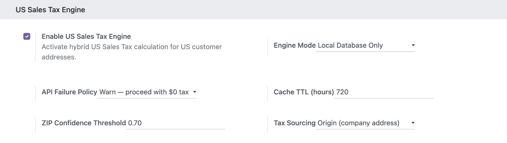

To configure this module, you need to:

1. Select, in the company switcher, the company or branch to configure: the
   setting is stored per company.
2. Go to *Settings > Invoicing > US Sales Tax Engine*. The *Tax Sourcing*
   setting is only shown when *Enable US Sales Tax Engine* is checked.
3. Choose the *Tax Sourcing* of the company:
   - *Destination (customer address)*, the default: new documents are rated
     with the customer's delivery address, as with the engine alone.
   - *Origin (company address)*: new sales orders and customer invoices are
     rated with the company address when the customer is in the company's
     state. The company needs a 5-digit ZIP, a state and United States as
     country; otherwise the setting cannot be saved, and that address cannot
     be left incomplete afterwards, neither on the company nor on its contact.
     The whole rate comes from the company address: see the roadmap for
     states with mixed sourcing, such as California.
4. Save.

Changing the setting only affects documents created afterwards. Existing
documents keep the check they already have; the ones that exist when the module
is installed start with the check off, so their rating does not change.

With origin sourcing, the nexus that matters is the one in the state of the
company address, since that is the address being rated.
